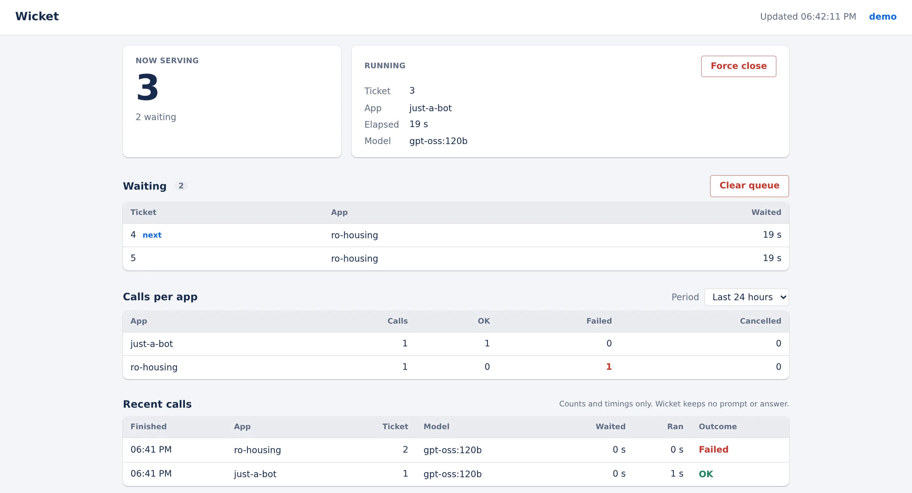
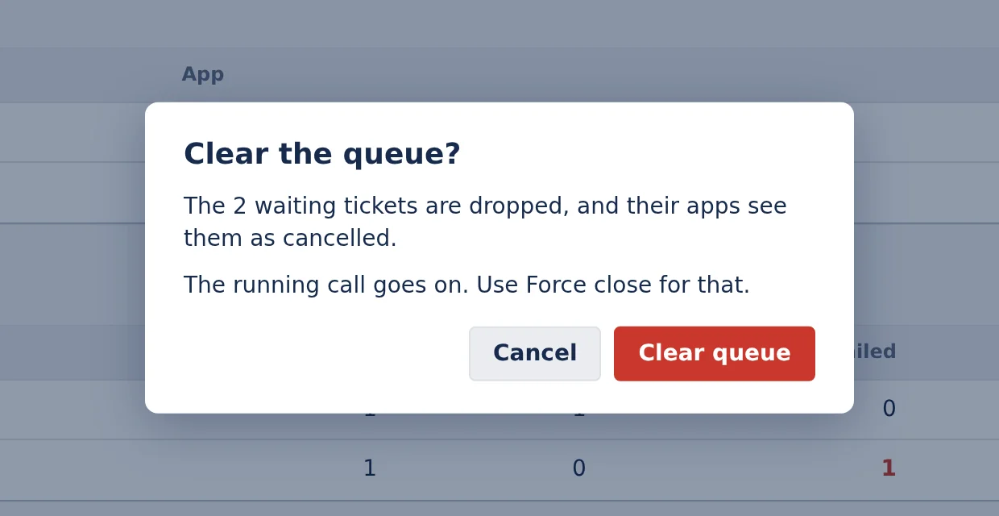
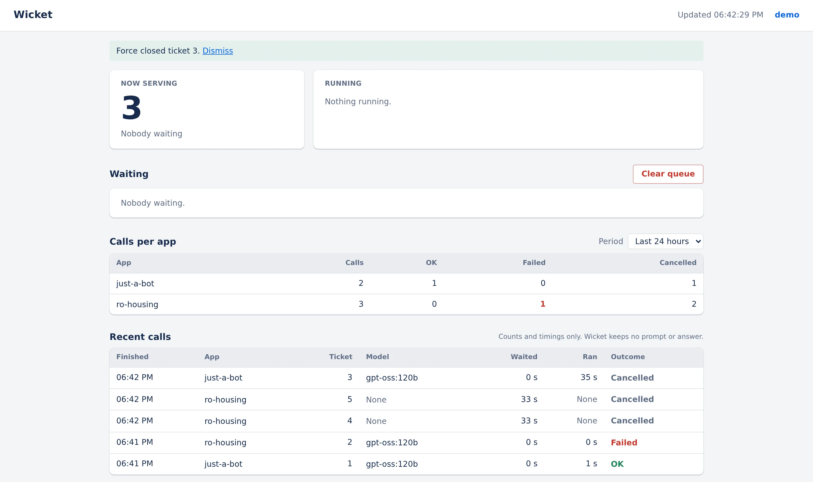

# Wicket

One queue for every LLM call a small set of self-hosted apps makes. It holds the Ollama key, puts every call in one first-come-first-served line with a ticket number, and runs one call at a time.

<p align="center">
  
</p>

**Status:** Personal tool, built 2026-11-04. Both containers were built and run together locally on 2026-11-04; not deployed yet. Putting it on a VPS is in [docs/owner-setup.md](docs/owner-setup.md).

A wicket is the small door in a big gate that lets people through one at a time.

## What it does

- Takes chat calls from apps over HTTP, each app with its own bearer token, and answers with a ticket number: "you're number 14, now serving 12".
- Runs one call at a time, in ticket order, on Ollama Cloud. When the cloud fails (an error, a timeout, a spent quota), the same call goes to a small backup model on the box, and the answer says so.
- Keeps a record of every call with counts and timings only: the app, the ticket, the model, cloud or backup, the wait, the run time and how it ended. Never the prompt or the answer.
- Shows the queue on a page behind sign-in, with **Force close** for a stuck call and **Clear queue** for everything waiting.
- Serves a small Prometheus `/metrics` on the box's loopback.

Without it, every app keeps its own copy of the key and two apps calling at once compete for one quota with nobody seeing it. Callers never choose a model, and there are no priorities or streaming. The queue lives in memory, so a restart cancels whatever waits.

## Screenshots

| Clear queue asks first | After a force close |
|---|---|
|  |  |

## How it works

Three npm workspaces. `shared` is the API contract as zod schemas. `server` is a Fastify API with SQLite for the records and the accounts; it holds the queue and talks to Ollama. `web` is the React page, which polls the API. On a VPS it runs as two containers: the API, and a capped Ollama with the backup model. More in [docs/architecture.md](docs/architecture.md).

```bash
curl -X POST "$WICKET_URL/v1/jobs" -H "Authorization: Bearer $WICKET_TOKEN" \
  -H 'content-type: application/json' \
  -d '{"messages":[{"role":"user","content":"Say hi"}]}'
# 202 {"id":"…","ticket":14,"nowServing":12,"position":2,"status":"queued"}

curl "$WICKET_URL/v1/jobs/<id>?wait=25" -H "Authorization: Bearer $WICKET_TOKEN"
# {"id":"…","ticket":14,"nowServing":14,"position":0,"status":"done","result":{"text":"Hi!","model":"gpt-oss:120b","backup":false}}
```

The full contract is in [corpus/wiki/api.md](corpus/wiki/api.md).

## Run it locally

Requires Node 24 or later, and an Ollama of your own with a model already pulled, for the backup.

```bash
npm install
cp .env.example .env            # then fill WICKET_APP_TOKENS, and WICKET_BACKUP_MODEL with a model you have
npm run seed -w @wicket/server  # your local account; asks for a username and password
npm run dev                     # API on 127.0.0.1:8808, page on http://localhost:5179/wicket/
```

Without `OLLAMA_API_KEY` every call goes straight to the backup model. Full setup, the settings, tests, "Sign in with Ward" and the container check: [docs/getting-started.md](docs/getting-started.md).

## Project layout

| Path | What lives there |
|---|---|
| `shared/` | The API contract as zod schemas |
| `server/` | The Fastify API: queue, providers, records, sign-in, `/metrics` |
| `web/` | The queue page (React, Vite) |
| `infrastructure/` | The API's Dockerfile and the compose file with the backup Ollama |
| `docs/` | Guides and the images used here |
| `docs-site/` | The Docusaurus docs site, built from the corpus and the code |
| `corpus/` | The project wiki: decisions, status, the briefs that built it |

## Docs

- [docs/](docs/README.md): guides, the architecture diagram and the images used here
- [docs/owner-setup.md](docs/owner-setup.md): putting Wicket on a VPS, and everything the deploy stack needs
- Docs site: `npm run docs` builds it into `docs-site/dist` (not deployed yet)
- [Project wiki](corpus/index.md): decisions, glossary, the API contract, status and the briefs that built it

## License

[MIT](LICENSE)
